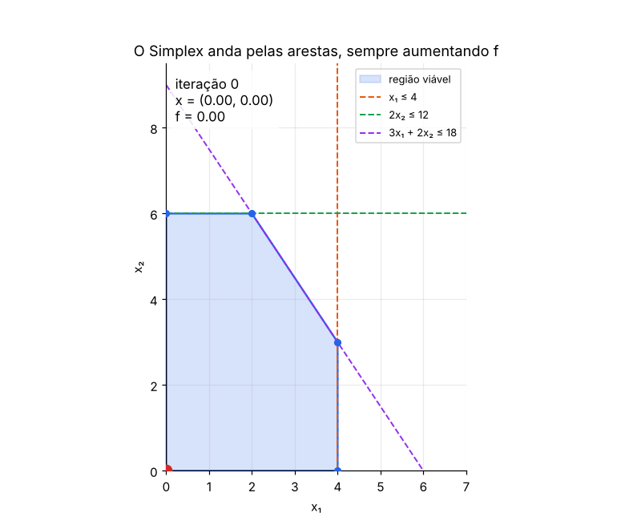
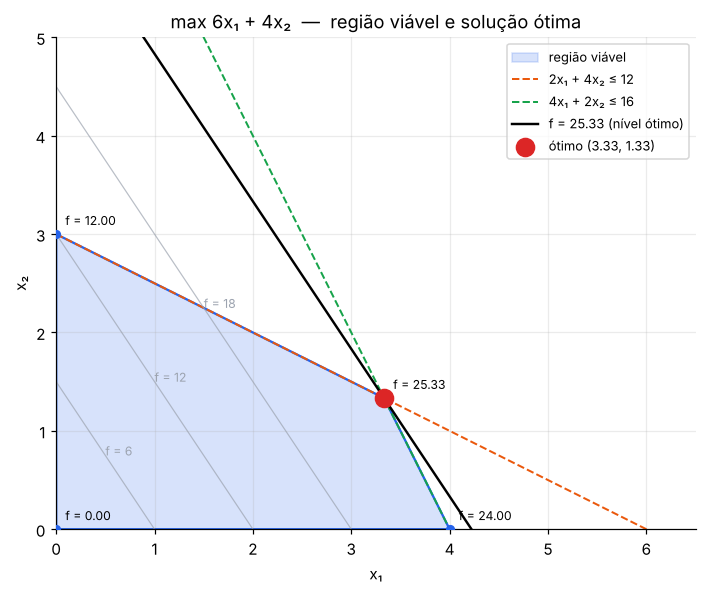
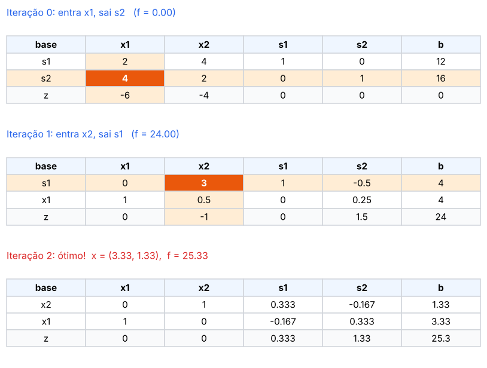
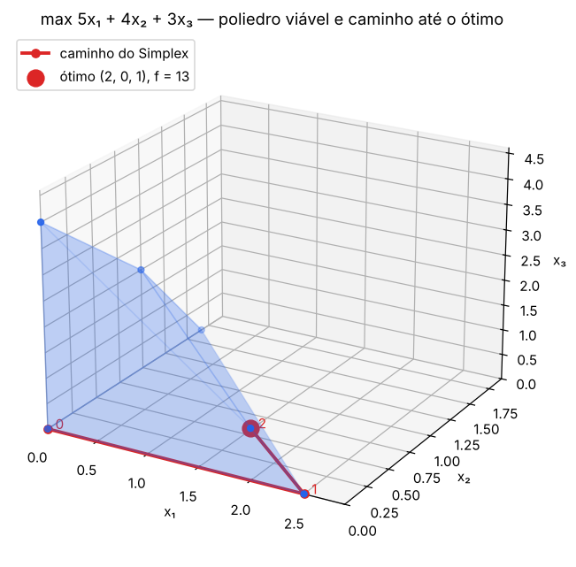

# Método Simplex, desenhado e explicado

<p align="center">
  
</p>

Como uma fábrica decide quanto produzir de cada produto para lucrar o máximo, sem estourar as horas de máquina, a matéria-prima e a mão de obra? Isso é **programação linear**, e o **método Simplex** é o algoritmo clássico para resolver. Este repositório implementa o Simplex do zero em Python (só com NumPy), com gráficos e código comentado linha a linha.

> Não precisa saber álgebra linear avançada para acompanhar os gráficos. As contas estão aqui para quem quiser ligar a teoria ao código.

---

## Sumário
1. [A ideia em uma frase](#1-a-ideia-em-uma-frase)
2. [O problema, peça por peça](#2-o-problema-peça-por-peça)
3. [Do papel para o código: o tableau](#3-do-papel-para-o-código-o-tableau)
4. [Os exemplos](#4-os-exemplos)
5. [Como rodar](#5-como-rodar)
6. [Para ir além](#6-para-ir-além)

---

## 1. A ideia em uma frase

> **O ótimo de um problema linear está sempre num vértice da região viável, então basta andar de vértice em vértice, sempre melhorando, até não dar mais para melhorar.**

As restrições formam um polígono (em 2D) ou um poliedro (em 3D ou mais). A função objetivo é um "plano inclinado" sobre ele. Se você empurrar esse plano para cima o máximo possível, ele vai encostar no poliedro por último numa ponta: um vértice. O Simplex é um jeito organizado de visitar só alguns vértices até achar essa ponta.

---

## 2. O problema, peça por peça

O formato padrão que este código resolve:

$$
\max_{x}\; c^T x
\qquad \text{sujeito a} \qquad
A x \le b, \qquad x \ge 0, \qquad (b \ge 0)
$$

| Símbolo | Nome | O que significa |
|---|---|---|
| $x$ | variáveis de decisão | o que você escolhe: quanto produzir de cada coisa |
| $c$ | coeficientes do objetivo | quanto cada unidade de $x_j$ rende (lucro, por exemplo) |
| $A$ | matriz de restrições | quanto de cada recurso cada $x_j$ consome |
| $b$ | lado direito | quanto de cada recurso existe |
| $m$, $n$ | tamanhos | $m$ restrições, $n$ variáveis |

### O exemplo da aula

$$
\begin{aligned}
\max\;\; & f(x) = 6x_1 + 4x_2 \\
\text{s.a.}\;\; & 2x_1 + 4x_2 \le 12 \\
& 4x_1 + 2x_2 \le 16 \\
& x_1,\, x_2 \ge 0
\end{aligned}
$$

<p align="center">
  
</p>

As retas cinzas são **curvas de nível** de $f$: todos os pontos com o mesmo valor de $f$. Elas são paralelas. Aumentar $f$ é empurrar a reta para cima e para a direita. A última posição em que ela ainda toca a região azul é a reta preta, e ela toca exatamente no vértice vermelho:

$$
x^* = \left(\tfrac{10}{3},\, \tfrac{4}{3}\right) \approx (3{,}33;\ 1{,}33)
\qquad
f(x^*) = \tfrac{76}{3} \approx 25{,}33
$$

Repare nos valores de $f$ nos vértices: 0, 12, 24 e 25,33. O maior deles é o ótimo. Com 4 vértices daria para testar todos; com 50 variáveis e 50 restrições, o número de vértices passa de $10^{28}$. Por isso o Simplex não testa todos: ele só anda para vizinhos melhores.

---

## 3. Do papel para o código: o tableau

### Passo 1: folgas transformam desigualdades em igualdades

Para cada restrição $\le$ criamos uma variável de **folga** $s_i \ge 0$, que mede "quanto do recurso sobrou":

$$
2x_1 + 4x_2 + s_1 = 12
\qquad\qquad
4x_1 + 2x_2 + s_2 = 16
$$

E escrevemos o objetivo como uma equação também: $z - 6x_1 - 4x_2 = 0$.

### Passo 2: montar o tableau (`_inicial_tableau`)

Tudo vira uma matriz só:

$$
\left[\begin{array}{cc|cc|c}
A & & I & & b \\ \hline
-c & & 0 & & 0
\end{array}\right]
\quad = \quad
\left[\begin{array}{cc|cc|c}
2 & 4 & 1 & 0 & 12 \\
4 & 2 & 0 & 1 & 16 \\ \hline
-6 & -4 & 0 & 0 & 0
\end{array}\right]
$$

No começo as **variáveis básicas** são as folgas ($s_1 = 12$, $s_2 = 16$) e $x_1 = x_2 = 0$. Ou seja: começamos na origem, que é viável porque $b \ge 0$.

### Passo 3: pivotar (`_pivotacao`)

Cada volta do laço faz quatro coisas, na mesma ordem dos comentários do código:

| Etapa | Regra | Por quê |
|---|---|---|
| **Coluna pivô** (quem entra na base) | o valor **mais negativo** da linha $z$ | é a variável que mais aumenta $f$ por unidade |
| **Linha pivô** (quem sai da base) | a **menor razão** $b_i / a_{i,\text{col}}$, só com $a_{i,\text{col}} > 0$ | é a restrição que "trava" primeiro quando a variável cresce; passar disso sai da região viável |
| **Pivô = 1** | divide a linha pivô pelo pivô | a variável que entra passa a ter coeficiente 1 |
| **Atualiza as outras linhas** | subtrai múltiplos da linha pivô até zerar a coluna | a variável que entra some das outras equações (eliminação de Gauss-Jordan) |

**Critério de parada:** quando a linha $z$ não tem mais nenhum número negativo, aumentar qualquer variável não-básica só diminuiria $f$. Chegamos ao ótimo.

<p align="center">
  
</p>

No exemplo:
- **Iteração 0:** o mais negativo na linha $z$ é $-6$ → entra $x_1$. Razões: $12/2 = 6$ e $16/4 = 4$ → sai $s_2$. Andamos de $(0, 0)$ para $(4, 0)$, com $f = 24$.
- **Iteração 1:** ainda tem $-1$ na coluna $x_2$ → entra $x_2$. Razões: $4/3 \approx 1{,}33$ e $4/0{,}5 = 8$ → sai $s_1$. Andamos para $(10/3,\, 4/3)$, com $f = 25{,}33$.
- **Iteração 2:** linha $z$ sem negativos. Fim.

### Passo 4: ler a resposta (`solve`)

Cada variável básica vale o número da coluna $b$ na sua linha. As não-básicas valem zero. O valor ótimo fica no canto inferior direito do tableau.

### O código confere com a teoria?

```
$ python simplex.py
...
Solução ótima: x1 = 3.3333, x2 = 1.3333
Valor ótimo:   f(x) = 25.3333
Confere com a solução exata (10/3, 4/3) e f = 76/3.
```

Todos os exemplos também foram conferidos com o `scipy.optimize.linprog` e dão o mesmo resultado.

### Mapa do código

| Método | O que faz |
|---|---|
| `Simplex(c, A, b)` | guarda o problema, confere as dimensões e monta o tableau inicial |
| `_inicial_tableau()` | cria a matriz `[A | I | b]` com a linha `[-c | 0 | 0]` |
| `_pivotacao()` | o laço principal: escolhe o pivô e faz Gauss-Jordan até o ótimo |
| `solve()` | roda o laço e devolve `(solucao, valor_otimo)` |
| `historico` | lista com o tableau, a base, o pivô e o vértice de cada iteração (usado nos gráficos) |
| `imprimir_tableau()` | mostra um tableau no terminal, com o pivô entre colchetes |

---

## 4. Os exemplos

### 01 · O exemplo da aula
`exemplos/01_exemplo_aula.py` resolve o problema acima e desenha o poliedro, as restrições, as curvas de nível e o ótimo (a imagem da [seção 2](#o-exemplo-da-aula)).

### 02 · O caminho do Simplex
`exemplos/02_caminho_simplex.py` gera o GIF do topo. O problema é

$$
\max\; 3x_1 + 5x_2 \quad \text{s.a.} \quad x_1 \le 4,\quad 2x_2 \le 12,\quad 3x_1 + 2x_2 \le 18
$$

e o Simplex faz $(0, 0) \to (0, 6) \to (2, 6)$, com $f$ indo de 0 para 30 e depois para **36**. A reta preta é a curva de nível de $f$ passando pelo ponto atual: ela só sobe.

### 03 · Os tableaus passo a passo
`exemplos/03_tableaus.py` imprime cada tableau no terminal, explicando quem entra e quem sai, e salva a imagem da [seção 3](#passo-3-pivotar-_pivotacao).

### 04 · Três variáveis
O código não muda nada com mais variáveis. Em 3D a região viável é um poliedro de verdade, e o caminho continua indo de vértice em vértice. Usa o exemplo clássico do livro do Chvátal, cuja resposta é conhecida: $x^* = (2, 0, 1)$ e $f = 13$.

<p align="center">
  
</p>

### 05 · Sua vez
`exemplos/05_seu_problema.py` é um modelo para você trocar `c`, `A` e `b`. Vem com um problema de fábrica: mesas dão lucro 70 e cadeiras 50, com limite de horas de carpintaria e pintura. Resposta: **30 mesas e 40 cadeiras**, lucro **4100**. Com 2 variáveis o gráfico sai sozinho.

---

## 5. Como rodar

Precisa de Python 3.9+.

```bash
git clone https://github.com/Tolonio/metodo-simplex.git
cd metodo-simplex
pip install -r requirements.txt

python simplex.py                        # resolve o exemplo da aula e confere a resposta
python exemplos/01_exemplo_aula.py       # abre o gráfico e salva em imagens/
python exemplos/02_caminho_simplex.py    # gera o GIF (leva alguns segundos)
```

No Windows, troque `python` por `py` se o primeiro não funcionar. No VS Code, também dá para abrir qualquer arquivo e clicar em ▶.

Para usar no seu próprio código:

```python
from simplex import Simplex

solucao, valor_otimo = Simplex(c=[6, 4], A=[[2, 4], [4, 2]], b=[12, 16]).solve()
```

```
metodo-simplex/
├─ simplex.py            o motor: a classe Simplex
├─ exemplos/
│  ├─ 01_exemplo_aula.py
│  ├─ 02_caminho_simplex.py
│  ├─ 03_tableaus.py
│  ├─ 04_tres_variaveis.py
│  ├─ 05_seu_problema.py
│  └─ estilo.py          cores, pasta de saída e cálculo dos vértices, comuns a todos
└─ imagens/              gráficos gerados pelos exemplos
```

---

## 6. Para ir além

- **Restrições com $\ge$ ou $=$:** aí a origem deixa de ser viável e não dá para começar com as folgas na base. As saídas clássicas são o **método das duas fases** e o **Big-M**, que criam variáveis artificiais só para achar um primeiro vértice.
- **Minimizar:** $\min g(x)$ é o mesmo que $\max -g(x)$. Troque o sinal de $c$ e do resultado.
- **Degenerescência e ciclagem:** se duas razões empatam, o Simplex pode girar em falso sem sair do lugar. A **regra de Bland** (sempre escolher o menor índice) garante que ele termina.
- **Dualidade:** os números da linha $z$ embaixo das folgas no tableau final (aqui, $1/3$ e $4/3$) são os **preços-sombra**: quanto $f$ aumentaria se você tivesse uma unidade a mais de cada recurso.
- **Na prática:** solvers como o `scipy.optimize.linprog` (HiGHS), o Gurobi e o CPLEX usam versões muito otimizadas do Simplex e de métodos de pontos interiores, e resolvem problemas com milhões de variáveis.

### Exercícios
1. No exemplo da aula, mude o objetivo para $f = 2x_1 + 4x_2$. Em qual vértice fica o ótimo agora? Ele é único? *(Dica: compare a inclinação de $f$ com a da primeira restrição.)*
2. Aumente o lado direito da primeira restrição de 12 para 13. Quanto $f^*$ aumenta? Compare com o preço-sombra $1/3$.
3. Crie um problema ilimitado (por exemplo, `c = [3, 5]` com só a restrição $x_1 \le 4$) e veja a mensagem de erro do Simplex. Por que nada segura $x_2$?

---

Licença MIT. Use, estude e modifique à vontade.
